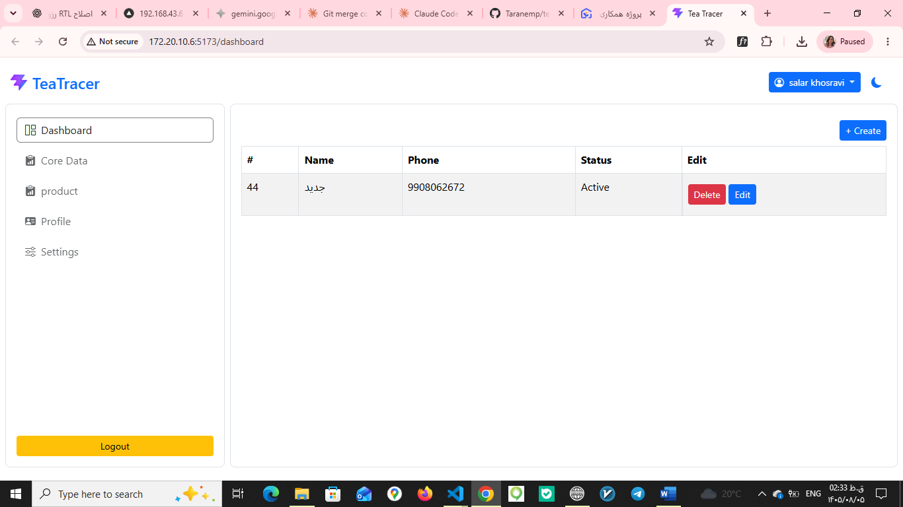

# Tea Warehouse Frontend

A modern, responsive frontend for a **tea factory warehouse management system**. It provides authentication, a private dashboard, factory management (full CRUD), and core product data screens, designed to work with a separate REST API backend.

## Features

- **Authentication**: login and registration, token-based sessions, and route guards for private pages
- **Factory management**: create, view, edit, and delete factories with a reusable form and table
- **Core data**: product management pages built on a reusable CRUD list table
- **Dashboard and profile**: user dashboard, profile, and settings pages
- **Theming**: light/dark theme support with a custom Bootstrap (SCSS) theme
- **Responsive layout**: sidebar, top bar, and mobile menu for desktop and mobile screens
- **User feedback**: loading spinners, toast notifications, and confirmation modals
- **CI**: GitHub Actions workflow included

## Tech Stack

- [React](https://react.dev/) with [Vite](https://vitejs.dev/)
- React Router for public/private routing
- Bootstrap 5 with a custom SCSS theme
- ESLint for code quality

## Project Structure

```
src/
├── auth/          # Auth context, route guard, auth services
├── components/    # Reusable UI (factory form/table, modals, toasts, spinner)
├── core_data/     # Core data pages (e.g. products)
├── crud/          # Generic CRUD list table
├── layout/        # Public/private layouts, theme provider, sidebar, topbar
├── pages/         # Page-level components (home, login, register, dashboard...)
├── routes/        # Public and private route definitions
├── scss/          # Custom Bootstrap theme
└── services/      # API client, auth API, token and theme services
```

## Getting Started

### Prerequisites

- Node.js 18 or newer
- npm
- A running instance of the backend API

### Installation

```bash
git clone https://github.com/Taranemp/tea-warehouse-frontend.git
cd tea-warehouse-frontend
npm install
```

### Environment Variables

Copy the example file and fill in your values:

```bash
cp .env.example .env.development
```

Example (check `.env.example` for the exact variable names):

```env
VITE_API_BASE_URL=http://localhost:8000/api
```

> Never commit real `.env` files. Only `.env.example` is tracked.

### Run the Development Server

```bash
npm run dev
```

The app will be available at `http://localhost:5173`.

### Build for Production

```bash
npm run build
npm run preview
```

## Available Scripts

| Script            | Description                          |
| ----------------- | ------------------------------------ |
| `npm run dev`     | Start the Vite development server    |
| `npm run build`   | Create an optimized production build |
| `npm run preview` | Preview the production build locally |
| `npm run lint`    | Run ESLint                           |

## Screenshots



## Roadmap

- [ ] Inventory and stock movement screens
- [ ] Reports and charts
- [ ] Role-based access control
- [ ] Persian (RTL) language support

## Author

**Taranemp**: [GitHub](https://github.com/Taranemp)

## License

This project is currently unlicensed. All rights reserved.